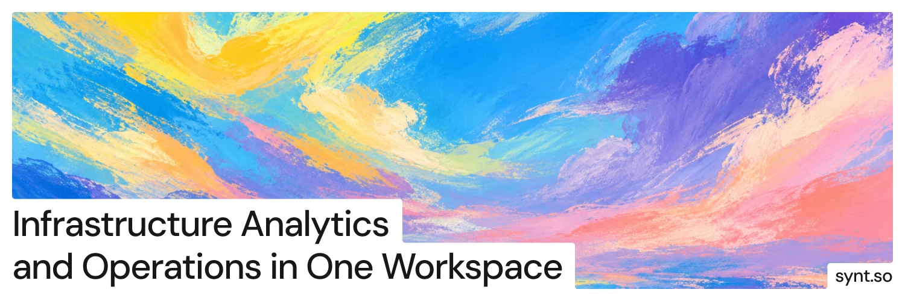

<p align="center">
  <a href="https://github.com/syntso/synt/releases/latest"></a>
  
  <a href="https://github.com/syntso/mcp"></a>
</p>

<p align="center">
  <b>A workspace for servers, Kubernetes clusters and databases.</b><br />
  You and your AI agents use the same actions, and nothing touches a host until you allow it.
</p>

<p align="center">
  <a href="https://synt.so">Website</a>
  &nbsp;·&nbsp;
  <a href="#install">Install</a>
  &nbsp;·&nbsp;
  <a href="#ai-agents">AI agents</a>
  &nbsp;·&nbsp;
  <a href="https://github.com/syntso/synt/releases">Releases</a>
</p>

<br />

This repository is where Synt is published. The builds of every version are under [Releases](https://github.com/syntso/synt/releases).

<br />

## What's inside

<table>
  <tr><td><b>SSH</b></td><td>ProxyJump, terminal sessions that track each command, resumable file transfers, tunnels</td></tr>
  <tr><td><b>Kubernetes</b></td><td>Clusters reached directly or through an SSH host; apply with a server-side diff, logs, exec, port-forward</td></tr>
  <tr><td><b>Databases</b></td><td>PostgreSQL, MySQL, SQLite and Redis; every statement is judged by what it does, reads run read-only</td></tr>
  <tr><td><b>Runbooks</b></td><td>Steps with checks, retries and rollback; drafted from your terminal, exported as a shell script</td></tr>
  <tr><td><b>AI agents</b></td><td>An <a href="https://modelcontextprotocol.io">MCP</a> way in with the same actions and approvals as you</td></tr>
  <tr><td><b>Extensions</b></td><td>WebAssembly in a sandbox: actions, native views, web panels, documents</td></tr>
  <tr><td><b>Sync</b></td><td>Projects shared between devices and teammates, end-to-end encrypted</td></tr>
  <tr><td><b>Journal</b></td><td>Every call recorded in a hash chain that can be verified but not rewritten</td></tr>
</table>

<br />

## How it works

<picture>
  <source media="(prefers-color-scheme: dark)" srcset="docs/images/how-it-works-dark.svg" />
  
</picture>

<br />

- Before an action touches a host, Synt asks you: once, until restart, or always. Privileged commands from an agent are asked every time.
- SSH keys and passwords stay in the system keychain. Agents and extensions refer to them by name.
- Requests, approvals and outcomes go to the journal, without the data itself.

<br />

## Install

The core is a single program, `synt-core`. Pick the archive for your system:

| System | Archive |
|---|---|
| macOS, Apple silicon | `synt-core-macos-arm64.tar.gz` |
| macOS, Intel | `synt-core-macos-x64.tar.gz` |
| Linux, x86-64 | `synt-core-linux-x64.tar.gz` |
| Linux, ARM64 | `synt-core-linux-arm64.tar.gz` |
| Windows, x86-64 | `synt-core-windows-x64.zip` |

### macOS and Linux

```bash
curl -fsSLO https://github.com/syntso/synt/releases/latest/download/synt-core-macos-arm64.tar.gz
curl -fsSLO https://github.com/syntso/synt/releases/latest/download/SHA256SUMS
shasum -a 256 -c SHA256SUMS --ignore-missing
tar -xzf synt-core-macos-arm64.tar.gz
mkdir -p ~/.local/bin && mv synt-core ~/.local/bin/
```

Use the archive name for your system in the first line. On Linux, `sha256sum -c SHA256SUMS --ignore-missing` does the same check.

The macOS builds are not signed yet. Until they are, start the core with `--allow-login-keychain`: it then keeps its journal key in your login keychain, which other programs of your user can read.

### Windows

```powershell
Invoke-WebRequest https://github.com/syntso/synt/releases/latest/download/synt-core-windows-x64.zip -OutFile synt-core.zip
Expand-Archive synt-core.zip -DestinationPath "$env:LOCALAPPDATA\Synt"
```

<br />

## AI agents

[Synt MCP](https://github.com/syntso/mcp) gives Claude Code, Claude Desktop, Cursor, Codex, VS Code and any other MCP client the actions of Synt as tools. With the core in `~/.local/bin`:

```bash
claude mcp add synt -- synt-mcp --core ~/.local/bin/synt-core
```

On macOS, add `--allow-login-keychain` at the end until the builds are signed.

Setup for every client is in [its README](https://github.com/syntso/mcp#connect-your-client).

<br />

## License

Synt is closed source. The parts others build on are open, starting with [mcp](https://github.com/syntso/mcp).
